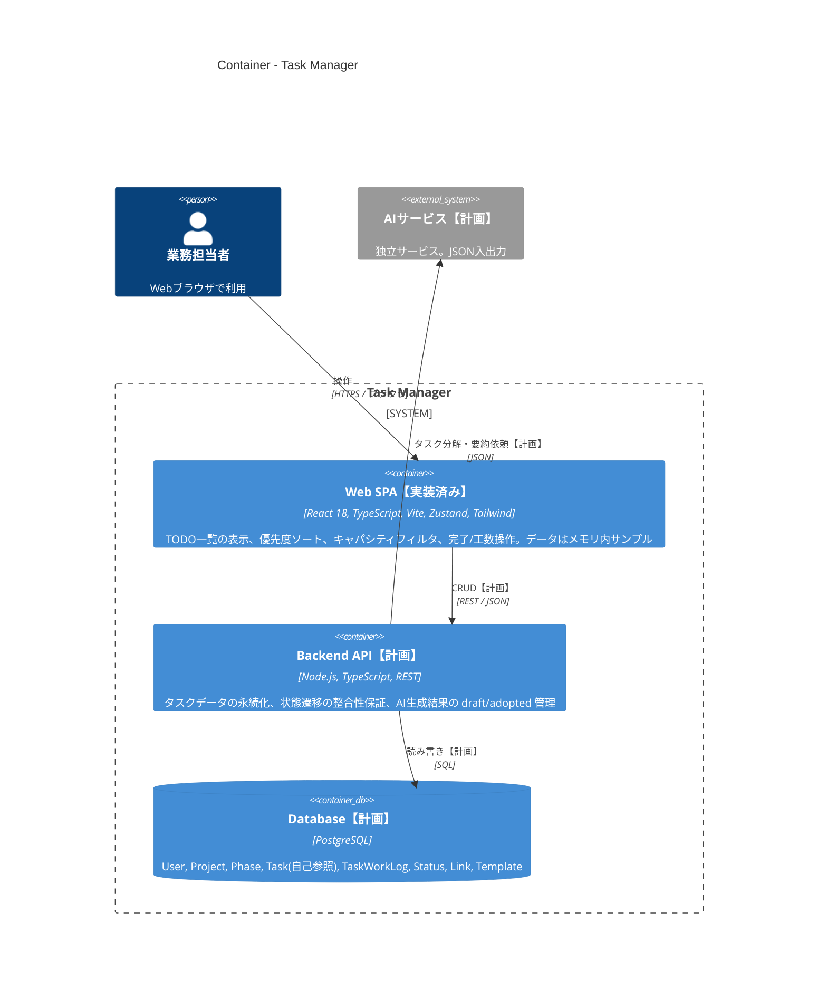

# Task Manager — Demo Implementation

## アーキテクチャ概要

現在は **ブラウザ内で完結するフロントエンドSPA（`web/`）のみ実装済み**で、バックエンドAPI・PostgreSQL・AI連携は設計書に基づく【計画】段階です。

System Context / Component 図、データフロー、ディレクトリ構成の詳細は [docs/architecture.md](docs/architecture.md) を参照してください。

---

このリポジトリに、`docs/` 以下の設計書を基にしたブラウザ版 (フロントエンドのみ) の最小実装を追加しました。

## 実装概要
- `web/` に Vite + React + TypeScript プロジェクト
- Tailwind, Zustand を使用
- 実装済み: TODO一覧画面（並び順、期日強調、状態チップ、完了ボタン、工数ログ(+30m)、キャパシティフィルタ、タスク詳細モーダル）

## 使い方（ローカル）
1. cd web
2. npm install
3. npm run dev

ブラウザで表示されるTODO一覧を確認できます（データはメモリ内のサンプルデータ）。

## 次のステップ候補
- バックエンドAPI（Node.js + PostgreSQL）と接続して永続化
- AI連携インターフェース（設計書にある入出力フォーマット準拠）
- 詳細ページ（フェーズ・サブタスク編集など）
- テスト、アクセシビリティ改善

---

短いデモを作成しました。続けてバックエンドやAI連携など、どこから作業しますか？
