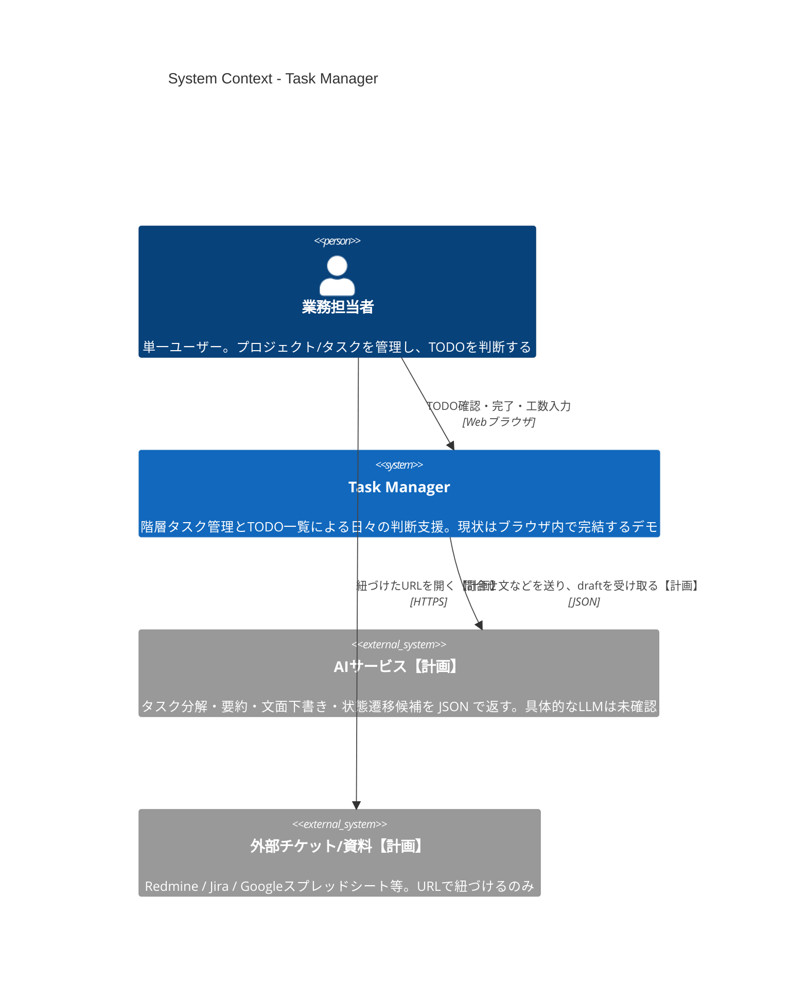
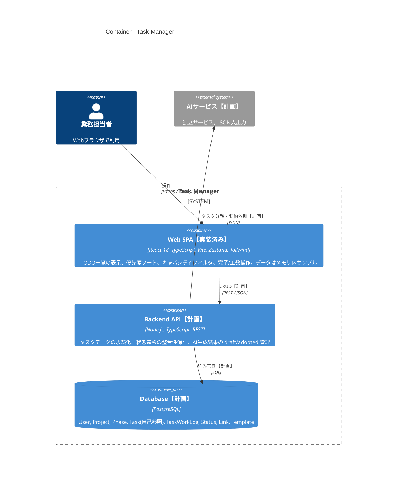
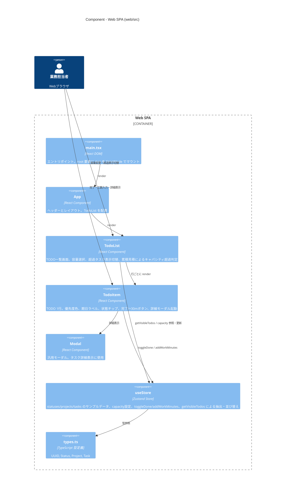
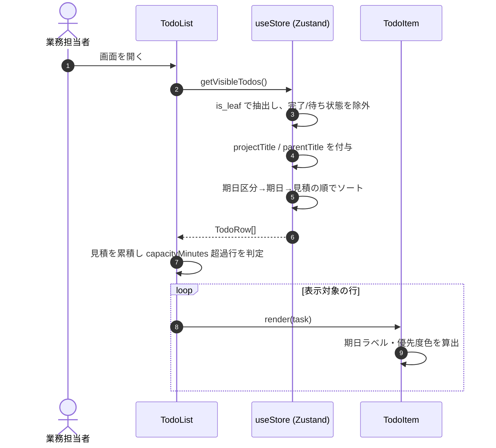
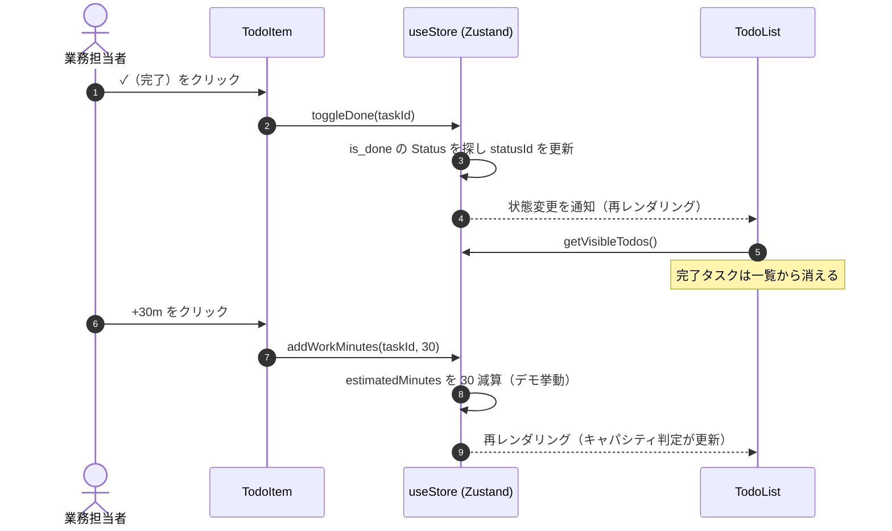
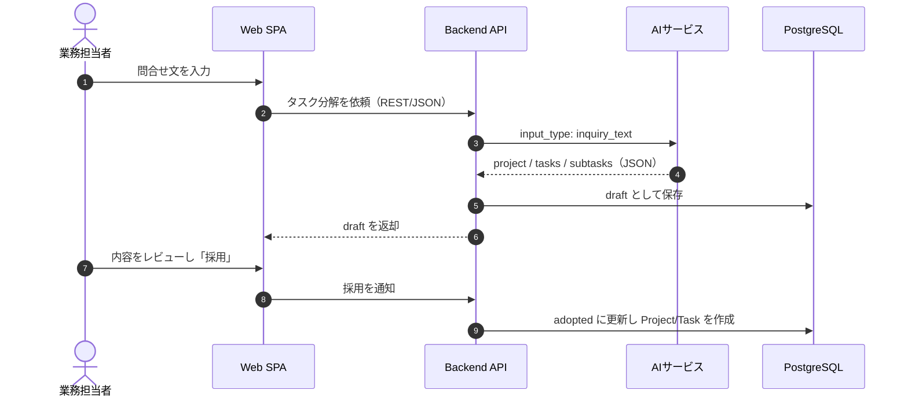

# アーキテクチャ（C4モデル）

本書は `task-manager` リポジトリのアプリケーション構成を、C4モデル（Context / Container / Component）で整理したものです。
記述はリポジトリ内のコード・設定ファイル・設計書（`docs/Arc-*.md`）に基づいています。確認できない点は「未確認」と明記しています。

> **凡例**
> - **【実装済み】** … `web/` 配下にコードとして存在するもの
> - **【計画】** … 設計書 `docs/Arc-Tec.md` / `docs/Arc-ER.md` に記載があるが、コードは未実装のもの

---

## 1. 概要

### 1.1 アプリの目的

個人の業務（問合せ対応・開発・レビュー・提出物など）を「プロジェクト → タスク → サブタスク」の階層で管理し、
**TODO一覧で「今これをやるか／やらないか」を即決できる**ようにするタスク管理アプリです（`docs/Arc-UI.md`, `docs/Arc-UI_TodoList.md`）。
設計思想として「人は判断だけを行い、記述・整理・要約・分解はAIに委譲する」ことを掲げています（`docs/Arc-Tec.md`）。

現時点のリポジトリには、**ブラウザだけで動くフロントエンドのデモ実装（TODO一覧画面のみ）**が含まれます。
データはメモリ上のサンプルデータで、永続化・バックエンド・AI連携は未実装です（ルート `README.md`, `web/README.md`）。

### 1.2 主な利用者

| 利用者 | 説明 | 根拠 |
|---|---|---|
| 業務担当者（単一ユーザー） | 自分のプロジェクト／タスクを管理し、日々のTODOを判断する | `docs/Arc-Tec.md`「初期は単一ユーザー想定」, `docs/Arc-ER.md` 2.1 |

### 1.3 技術スタック

| 区分 | 技術 | バージョン（`web/package.json`） | 状態 |
|---|---|---|---|
| 言語 | TypeScript | ^5.2.2 | 実装済み |
| UIライブラリ | React / React DOM | ^18.2.0 | 実装済み |
| ビルド／開発サーバ | Vite + @vitejs/plugin-react | ^5.0.0 / ^4.0.0 | 実装済み |
| 状態管理 | Zustand | ^4.4.0 | 実装済み |
| 日付操作 | dayjs | ^1.11.8 | 実装済み |
| スタイル | Tailwind CSS + PostCSS + Autoprefixer | ^3.4.7 / ^8.4.24 / ^10.4.14 | 実装済み |
| UIコンポーネント | shadcn/ui | — | 計画（設計書記載のみ、依存なし） |
| バックエンド | Node.js（TypeScript）, REST API | — | 計画 |
| データベース | PostgreSQL | — | 計画 |
| AI連携 | 独立サービス・JSON構造化入出力（具体的なLLM/ベンダーは未確認） | — | 計画 |
| 認証 | 将来対応（初期は単一ユーザー） | — | 計画 |
| テスト / Lint | なし（`package.json` に定義なし） | — | 未整備 |
| CI / Docker / IaC | なし（`.github/`, `Dockerfile`, IaC ファイルは存在しない） | — | 未整備 |
| ホスティング／デプロイ先 | 未確認（設定なし。ローカルの `npm run dev` のみ） | — | 未確認 |

---

## 2. Level 1: System Context 図



| 名前 | 種別 | 技術 | 責務 |
|---|---|---|---|
| 業務担当者 | Person | Webブラウザ | プロジェクト・タスクの登録、TODO一覧での「やる／やらない」の判断、完了・工数入力、AI生成結果の採用判断 |
| Task Manager | Software System（本システム） | React SPA（現状）／Node.js + PostgreSQL（計画） | 階層タスクの管理、優先度・キャパシティに基づくTODO一覧の提示 |
| AIサービス | External System【計画】 | 未確認（JSON構造化入出力・プロンプトはコード管理の方針） | 問合せ文からのタスク分解、背景文要約、回答文下書き、状態遷移候補の提示。結果は常に draft 扱い |
| 外部チケット/資料 | External System【計画】 | Redmine / Jira / GSS / その他（`Link.link_type`） | プロジェクト／タスクに紐づく外部情報源。API連携ではなくURL紐づけ（`docs/Arc-ER.md` 2.7） |

---

## 3. Level 2: Container 図



| 名前 | 種別 | 技術 | 責務 |
|---|---|---|---|
| Web SPA | Container【実装済み】 | React 18 / TypeScript / Vite 5 / Zustand 4 / Tailwind 3 / dayjs | TODO一覧の表示ロジック（優先度算出・並び順・キャパシティフィルタ）、一時的な判断状態の保持、AI生成結果のレビュー（計画）。現状は `npm run dev` / `npm run build` で静的ファイルとして配信。配信先は未確認 |
| Backend API | Container【計画】 | Node.js（TypeScript）, REST（将来 GraphQL 化の余地） | 正規化データの永続化、状態遷移の整合性保証、AI生成結果の保存（draft / adopted 区別）。認証は将来対応 |
| Database | Container【計画】 | PostgreSQL | 階層タスク（自己参照）、状態履歴、工数ログの保存と将来の分析用途。スキーマは `docs/Arc-ER.md` の論理ERのみ（DDL・マイグレーションは未作成） |
| AIサービス | External System【計画】 | 未確認 | 入出力はJSONで構造化。AIが自動確定はせず、人が採用して初めて正となる |

> **補足**: 現時点で実在する実行単位は **Web SPA のみ**です。ストレージ、バッチ、外部SaaS、認証基盤への接続コードは存在しません。

---

## 4. Level 3: Component 図（Web SPA）

最も中心的（かつ唯一実装済み）のコンテナである **Web SPA**（`web/src`）の内部構成です。



| 名前 | 種別 | 技術 | 責務 |
|---|---|---|---|
| `main.tsx` | Component（エントリポイント） | React DOM `createRoot` | `index.html` の `#root` に `<App />` をマウントし、`index.css`（Tailwind）を読み込む |
| `App` (`App.tsx`) | Component | React | 画面レイアウト（ヘッダー＋メイン）。ルーティングは無し |
| `TodoList` (`components/TodoList.tsx`) | Component | React, Zustand | 表示対象TODOの取得、容量（4h/6h/7h/8h）選択、見積工数の累積によるキャパシティ超過判定と超過行の非表示/薄表示 |
| `TodoItem` (`components/TodoItem.tsx`) | Component | React, dayjs, Zustand | 期日ラベル（期限超過／今日／明日／N日後）と優先度色、状態名チップ、完了ボタン、工数+30mボタン、詳細モーダル |
| `Modal` (`components/Modal.tsx`) | Component | React, Tailwind | オーバーレイ付き汎用モーダル |
| `useStore` (`store/useStore.ts`) | Component（状態管理） | Zustand, dayjs | メモリ内サンプルデータ保持、状態更新アクション、`getVisibleTodos`（is_leaf かつ 完了/待ちでないタスクを抽出し、期限超過→今日→明日→その他→期日なし の順、同順位は期日昇順→見積降順で並べ替え） |
| `types.ts` | Component（型定義） | TypeScript | ドメイン型 `Status` / `Project` / `Task` の定義（ER図の一部をフロント用に簡略化） |

> **注**: `addWorkMinutes` はデモ実装のため、工数ログ（`TaskWorkLog`）を記録せず `estimatedMinutes` を減算する挙動です（コード内コメント「For demo we just subtract estimatedMinutes as if logged」）。

---

## 5. 主要なデータフロー

### 5.1 TODO一覧の表示（実装済み）



### 5.2 完了・工数入力（実装済み）



### 5.3 AIによるタスク分解（計画・未実装）

`docs/Arc-Tec.md` 6-4 / 6-5 の方針を図示したものです。API のエンドポイント名等は未確認（未設計）です。



---

## 6. ディレクトリ構成

```
task-manager/
├── README.md                 # リポジトリ概要（デモ実装の説明・起動手順）
├── .DS_Store                 # macOS のメタファイル（アプリとは無関係）
├── docs/                     # 設計書
│   ├── architecture.md       # 本書（C4モデルによるアーキテクチャ図）
│   ├── Arc-Tec.md            # 使用技術方針（フロント/バック/DB/AI連携）
│   ├── Arc-ER.md             # 論理ER図（User, Project, Phase, Task, TaskWorkLog, Status, Link, Template）
│   ├── Arc-UI.md             # UI設計（必須画面とカード構成）
│   └── Arc-UI_TodoList.md    # TODO一覧の1行定義・並び順・キャパシティフィルタ
└── web/                      # フロントエンド（Vite + React + TypeScript）
    ├── README.md             # web 単体の起動手順
    ├── package.json          # 依存定義・npm scripts（dev / build / preview）
    ├── package-lock.json     # 依存ロックファイル
    ├── index.html            # SPA の HTML エントリ（/src/main.tsx を読み込む）
    ├── vite.config.ts        # Vite 設定（React プラグインのみ）
    ├── tsconfig.json         # TypeScript 設定（strict, ES2020）
    ├── tailwind.config.cjs   # Tailwind 設定
    ├── postcss.config.cjs    # PostCSS 設定（tailwindcss, autoprefixer）
    ├── .gitignore
    └── src/
        ├── main.tsx          # エントリポイント
        ├── App.tsx           # ルートコンポーネント
        ├── index.css         # Tailwind ディレクティブ
        ├── types.ts          # ドメイン型定義
        ├── store/
        │   └── useStore.ts   # Zustand ストア（サンプルデータ・表示ロジック）
        └── components/
            ├── TodoList.tsx  # TODO一覧
            ├── TodoItem.tsx  # TODO 1行 + 詳細モーダル
            └── Modal.tsx     # 汎用モーダル
```

| ディレクトリ | 役割 |
|---|---|
| `/` | リポジトリルート。README のみ（ビルド設定・CI・Docker なし） |
| `docs/` | 要件・設計書（技術方針、ER、UI）と本アーキテクチャ文書 |
| `web/` | 唯一の実行可能アプリ（フロントエンド SPA）。設定ファイル群を含む |
| `web/src/` | アプリケーションコード |
| `web/src/components/` | 画面を構成する React コンポーネント |
| `web/src/store/` | Zustand によるグローバル状態とドメインロジック（抽出・並び替え） |

---

## 7. 未確認事項・ギャップ

- **デプロイ／ホスティング先**: 設定ファイルが無く未確認。
- **環境変数・外部接続先**: `.env` や API URL の参照コードは無し。
- **AIサービスの具体的な実装（LLM ベンダー、モデル、プロンプト管理場所）**: 未確認（設計方針のみ）。
- **認証方式**: 「将来対応」とのみ記載。
- **バックエンド／DB**: 設計書に方針と論理ERはあるが、コード・DDL・マイグレーションは存在しない。
- **設計書の画面のうち未実装のもの**: プロジェクト一覧、プロジェクト詳細、タスク一覧、タスク詳細、タイムテーブル（`docs/Arc-UI.md`）。
